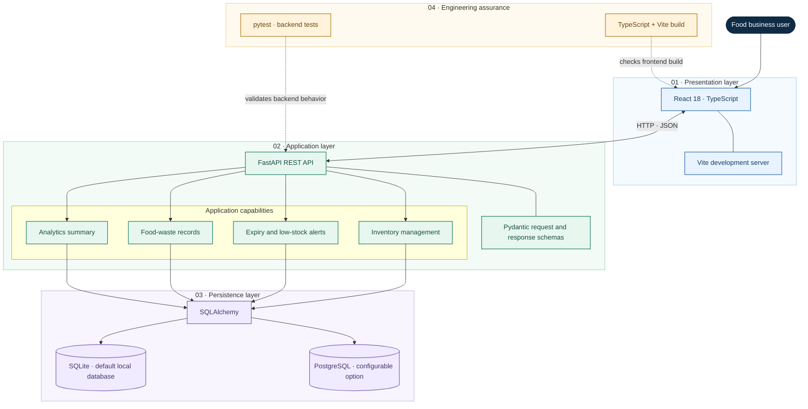
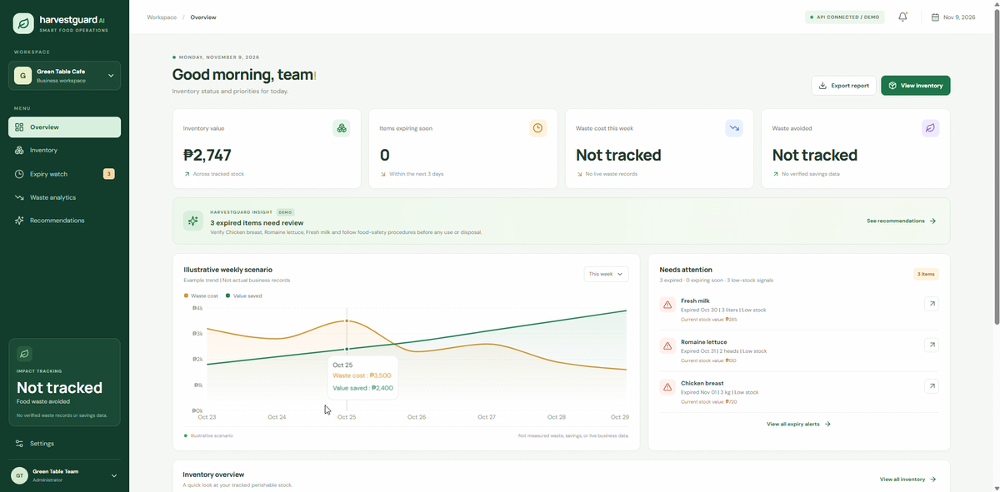
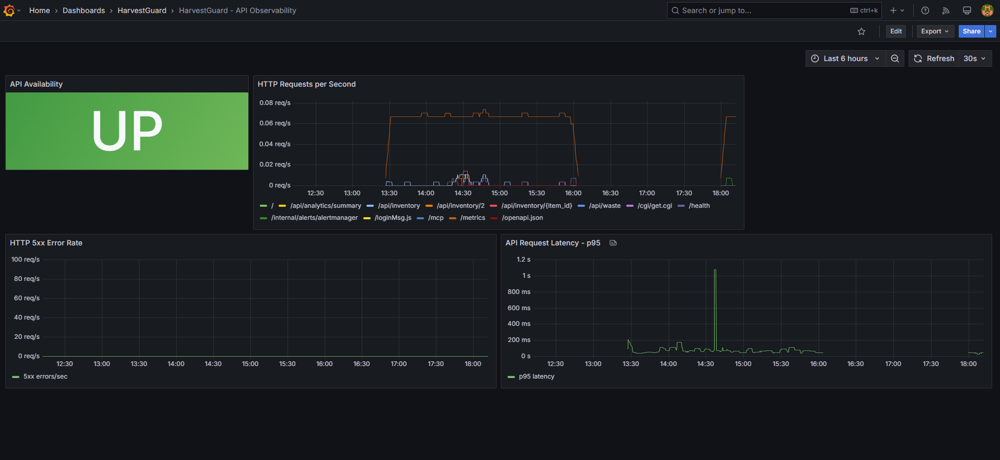
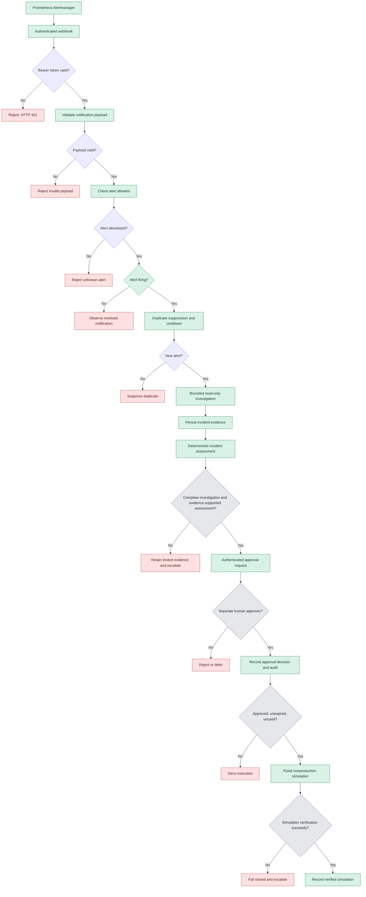

# HarvestGuard AI

**Smart Food Waste Prevention & Inventory Intelligence**

HarvestGuard AI helps small food businesses track perishable inventory,
monitor expiry risks, analyze food waste, and improve stock decisions. It is a
full-stack project built with React, TypeScript, FastAPI, and SQLAlchemy, with
SQLite as the default local database and PostgreSQL support configured through
the database URL.

The project also emphasizes production-engineering practices, including
automated testing, documented architecture, observability and incident-response
planning. Features described as planned are distinguished from those currently
implemented.

## Problem

Small food businesses may lack accessible tools to understand perishable
inventory, expiry risk, waste patterns, and the cost of stock that goes unused.
HarvestGuard AI provides an application foundation for managing stock and
turning inventory and waste records into actionable information.

## Current application features

The backend currently exposes API routes for:

- Listing, creating, retrieving, updating, and deleting inventory items
- Identifying items approaching expiry
- Identifying low-stock items
- Recording and listing food-waste records
- Returning an analytics summary
- Reporting backend health through `/health`

The React frontend provides an inventory dashboard connected to the backend.
Automated backend tests are included. See the testing documentation and run the
commands below to verify the current checkout.

## Architecture

HarvestGuard AI uses a layered architecture that separates the user interface,
API responsibilities, and data persistence.



### Local service endpoints

| Component | Local address |
|---|---|
| React dashboard | `http://127.0.0.1:5174/` |
| FastAPI health check | `http://127.0.0.1:8001/health` |
| Interactive API documentation | `http://127.0.0.1:8001/docs` |
| Inventory API | `http://127.0.0.1:8001/api/inventory` |

The frontend sends HTTP requests to the FastAPI backend. The backend uses
SQLAlchemy for database access, with SQLite as its default local database.
PostgreSQL can be configured through `DATABASE_URL`.

The tests and frontend build are verification activities, not runtime services.

**Deployment note:** Docker Compose files and Dockerfiles are not present in
the inspected checkout. Container orchestration, production CI/CD, and
observability should be documented as operational only after implementation
and verification.

## Technology stack

| Area | Technology |
|---|---|
| Frontend | React 18, TypeScript, Vite 6 |
| UI and charts | Lucide React, Recharts |
| Backend API | Python, FastAPI, Uvicorn |
| Data access | SQLAlchemy 2 |
| Local database | SQLite by default |
| Database option | PostgreSQL using `DATABASE_URL` and psycopg |
| Validation | Pydantic |
| Backend tests | pytest, HTTPX |
| Frontend checks | TypeScript compiler and Vite production build |

Version ranges are defined in `frontend/package.json` and
`backend/requirements.txt`. Observability, CI/CD, containerization, and
production deployment plans are documented separately and should not be
considered operational merely because documentation exists.

## Repository structure

The repository structure below reflects the files tracked in the current Git commit.

**Tracked files: 78**

```text
harvestguard-ai/
├── .github/
│   └── workflows/
│       ├── ci.yml
│       └── deploy-manual.yml
├── backend/
│   ├── app/
│   │   ├── __init__.py
│   │   ├── database.py
│   │   ├── main.py
│   │   ├── models.py
│   │   ├── observability.py
│   │   ├── oncall_webhook.py
│   │   ├── responder_policy.py
│   │   └── schemas.py
│   ├── migrations/
│   │   ├── versions/
│   │   │   └── 0001_initial_schema.py
│   │   ├── env.py
│   │   └── script.py.mako
│   ├── tests/
│   │   ├── test_api.py
│   │   ├── test_oncall_webhook.py
│   │   └── test_responder_policy.py
│   ├── .env.example
│   ├── alembic.ini
│   ├── Dockerfile
│   └── requirements.txt
├── docs/
│   ├── agents/
│   │   ├── phase-bootstrap-addendum.md
│   │   ├── responder-policy.md
│   │   └── team.md
│   └── images/
│       ├── harvestguard-dashboard.png
│       └── grafana-observability.png
├── README.md
│   ├── issues/
│   │   └── issue-plan.md
│   ├── acceptance-criteria.md
│   ├── architecture.md
│   ├── bootstrap-follow-up.md
│   ├── deployment.md
│   ├── development-process.md
│   ├── implementation-evidence.md
│   ├── incident-response.md
│   ├── issue-plan.md
│   ├── observability.md
│   ├── phase2-4-6-execution-evidence.md
│   ├── responder-policy.md
│   ├── rollback.md
│   ├── specification.md
│   ├── team.md
│   ├── tempo-alerting-execution-evidence.md
│   └── testing.md
├── frontend/
│   ├── src/
│   │   ├── api.ts
│   │   ├── App.tsx
│   │   ├── index.css
│   │   ├── main.tsx
│   │   ├── vite-env.d.ts
│   │   └── WasteManager.tsx
│   ├── .env.example
│   ├── Dockerfile
│   ├── index.html
│   ├── integrate_inventory_api.py
│   ├── nginx.conf
│   ├── package.json
│   ├── package-lock.json
│   ├── tsconfig.app.json
│   ├── tsconfig.json
│   ├── tsconfig.node.json
│   └── vite.config.ts
├── ops/
│   ├── grafana/
│   │   └── provisioning/
│   │       ├── dashboard-files/
│   │       │   └── harvestguard-overview.json
│   │       ├── dashboards/
│   │       │   └── provider.yml
│   │       └── datasources/
│   │           ├── prometheus.yml
│   │           └── tempo.yml
│   ├── alertmanager.yml
│   ├── alerts.yml
│   ├── prometheus.yml
│   └── tempo.yml
├── reports/
│   ├── master-audit-20261030-192549.md
│   └── remaining-work-20261030-193418.md
├── .dockerignore
├── .env.example
├── .gitignore
├── AGENTS.md
├── completion-audit-20261030-154254.txt
├── docker-compose.yml
├── HarvestGuard-Complete-Remaining.ps1
├── HarvestGuard-Complete-Rubric.ps1
├── Makefile
├── master-health-check.ps1
└── README.md
```

## Run locally on Windows

Prerequisites:

- Python with a compatible version for the backend dependencies
- Node.js and npm
- The repository cloned or checked out locally

### 1. Start the backend

Open a PowerShell terminal in the repository root:

```powershell
cd backend
python -m venv .venv
.\.venv\Scripts\python.exe -m pip install -r requirements.txt
.\.venv\Scripts\python.exe -m uvicorn app.main:app --reload --host 127.0.0.1 --port 8000
```

If the project's existing `backend\.venv` is already set up, you can use it
without recreating it. Leave this terminal running.

### 2. Start the frontend

Open a second PowerShell terminal in the repository root:

```powershell
cd frontend
npm ci
npm run dev -- --host 127.0.0.1
```

Leave the frontend terminal running as well.

### 3. Open the application

| Service | Local URL |
|---|---|
| Frontend dashboard | http://127.0.0.1:5174/ |
| Backend health check | http://127.0.0.1:8001/health |
| Backend API documentation | http://127.0.0.1:8001/docs |
| Inventory API | http://127.0.0.1:8001/api/inventory |

The frontend is configured to request the backend at
`http://127.0.0.1:8000`. Keep the backend running while using the dashboard.

## Run tests and build

From the repository root, run the backend tests:

```powershell
cd backend
$env:PYTHONPATH = (Get-Location).Path
.\.venv\Scripts\python.exe -m pytest .\tests -q
```

Build the frontend:

```powershell
cd ..\frontend
npm ci
npm run build
```

A successful frontend build verifies TypeScript compilation and the Vite
production build. Review any build warnings separately from build failures.

## Docker Compose and deployment status

The local development environment is orchestrated with Docker Compose. The verified local stack contains the FastAPI API, React frontend, PostgreSQL database, Prometheus, Grafana, Alertmanager, and Grafana Tempo.

Start the local stack from the repository root with:

```powershell
docker compose up -d --build
```

Validate the Compose configuration without changing running services:

```powershell
docker compose config --quiet
```

Public deployment is optional and has intentionally been deferred to avoid recurring hosting costs. No public production URL is claimed. GitHub Actions CI is configured to run backend tests and the frontend production build on pull requests and pushes to `main`; it becomes active on GitHub after this workflow is committed and pushed.

## Controlled On-Call Agent Design

HarvestGuard AI implements a bounded, fail-closed on-call workflow. The responder receives authenticated Alertmanager notifications, collects read-only operational evidence, assesses incidents deterministically, and requires separate human approval before its fixed nonproduction recovery simulation can execute.


## Application Demo & Observability

### HarvestGuard AI — Inventory Dashboard

<p align="center">
  
</p>

<p align="center">
  <em>
    HarvestGuard AI dashboard displaying API-connected demo inventory,
    expired stock alerts, and low-stock indicators.
    The displayed records are synthetic demonstration data.
  </em>
</p>

### Grafana — API Observability Dashboard

<p align="center">
  
</p>

<p align="center">
  <em>
    Grafana observability dashboard for HarvestGuard AI,
    illustrating the configured application monitoring environment.
  </em>
</p>

### Controlled on-call architecture and workflow

The following diagram distinguishes implemented capabilities from deployment and operational boundaries.



### Implemented stages

| Stage | Capability | Implementation boundary |
|---|---|---|
| 1 | Authenticated alert ingestion | Allowlisted Alertmanager notifications, payload validation, duplicate suppression, cooldown |
| 2 | Read-only investigation | Fixed health, Prometheus, and Tempo endpoints; bounded responses and timeouts |
| 3 | Incident assessment | Deterministic severity, symptoms, likely causes, confidence, and recommendations |
| 4 | Human approval | Separate authenticated requester and approver, expiry, one-time approval consumption, audit records |
| 5 | Controlled recovery simulation | Fixed `simulate_health_recovery` action in `nonproduction`; simulated verification only |

### Approval and execution boundary

Approval requests are accepted only when the incident has a complete investigation and an evidence-supported assessment. The assessment must explicitly retain `human_approval_required=true` and `recovery_authorized=false`.

The approval workflow uses separate operator and approver identities. Approval is time-limited, audited, and consumed once. The HTTP API selects the fixed action and environment; clients cannot supply an alternative recovery action or execution adapter.

The current recovery adapter is simulation-only. It does not restart a service or container, modify application data, clear a cache, change Docker configuration, or perform an external recovery operation. A verified simulation is not evidence that an actual service has recovered.

### Fail-closed requirements

- Unknown alerts and invalid authentication are rejected.
- Incomplete or unavailable evidence cannot qualify for recovery approval.
- Unknown actions and nonproduction-policy violations are rejected.
- Requester and approver identities must differ.
- Missing, rejected, expired, or consumed approval cannot authorize execution.
- Failed simulation verification or execution errors result in escalation.
- No arbitrary shell execution, model-generated SQL, or unrestricted business-record access is permitted.
- Production remediation and automatic approval are not implemented.

### Deployment and verification status

The backend test suite and frontend production build have passed locally. GitHub Actions CI has also passed for the committed CI workflow. These checks demonstrate software and test verification; they do not establish a currently running public deployment.

Public deployment remains intentionally deferred. The recovery implementation is a controlled simulation and must not be represented as production service remediation.

## Documentation

- [Product specification](docs/specification.md)
- [Architecture](docs/architecture.md)
- [Acceptance criteria](docs/acceptance-criteria.md)
- [Agent team](docs/agents/team.md)
- [Development process](docs/development-process.md)
- [Testing](docs/testing.md)
- [Deployment](docs/deployment.md)
- [Rollback](docs/rollback.md)
- [Observability](docs/observability.md)
- [Incident response](docs/incident-response.md)
- [GitHub Issues plan](docs/issues/issue-plan.md)

## Responsible use

Use synthetic data for demonstrations. Never commit credentials, API keys,
production data, or unnecessary personal information. The incident responder
must use explicitly permitted actions and verify recovery independently.

## Project status

The application includes a React frontend, FastAPI backend, inventory and waste
API routes, database integration, and backend tests. Additional production
engineering capabilities should be marked complete only after their acceptance
criteria have been tested and the results documented.


## 📋 Evaluation Rubric Alignment Matrix (12 Criteria / 24 Points)

| No | Criterion | Target Score | Evidence / Deliverable File | Summary |
| -- | --------- | ------------ | --------------------------- | ------- |
| 1 | Problem Description | 2 | README.md | Clearly explains the problem, system functionality, and expected behavior. |
| 2 | Product Specification | 2 | docs/specification.md, docs/acceptance-criteria.md, GitHub Issues | Specification, acceptance criteria, and public task tracker. |
| 3 | Agent Team Specification | 2 | docs/team.md, docs/development-process.md | Defines team responsibilities and collaboration process. |
| 4 | Context Management | 2 | AGENTS.md, docs/ | Project instructions and modular documentation. |
| 5 | Application | 2 | frontend/, backend/, docker-compose.yml | Full-stack application with PostgreSQL persistence. |
| 6 | Testing | 2 | backend/tests/, frontend/ | Backend tests and frontend production build. |
| 7 | Containerization | 2 | docker-compose.yml, backend/Dockerfile, frontend/Dockerfile | Containerized application and database. |
| 8 | Deployment | 2 | docs/deployment.md, deployment evidence | Production deployment or public demo evidence required. |
| 9 | CI/CD | 3 | .github/workflows/ci.yml, deploy-manual.yml | CI verification and deployment workflow evidence. |
| 10 | Observability | 2 | backend/app/observability.py, ops/, Grafana dashboard | Structured logs, metrics, traces, and monitoring. |
| 11 | Alerting on User Impact | 1 | ops/alerts.yml, ops/alertmanager.yml | User-impact alert rules and alert delivery. |
| 12 | On-Call Agent | 2 | backend/app/oncall_webhook.py, backend/app/responder_policy.py | Alert handling, investigation, and issue remediation evidence required. |
 
**Maximum score: 24 points**

### Problem Description

- The problem is not described. (0 points)
- The problem is described briefly, but it is unclear what the system does or what functionality is expected. (1 point)
- The README clearly describes the problem, the system functionality, and expected behavior. (2 points)

### Product Specification

- No written specs. (0 points)
- A spec exists, but no public task tracker. (1 point)
- A specification exists and there's a publicly accessible task tracker. The tasks define acceptance criteria and there's evidence that the agents used the tracker. (2 points)

### Agent Team Specification

- No agent team described. (0 points)
- Roles or agents are mentioned, but responsibilities are unclear. (1 point)
- The project defines the agent team and process of how they work together. (2 points)

### Context Management

- No project docs. (0 points)
- An AGENTS.md (or equivalent) exists and describes the project. (1 point)
- AGENTS.md exists and it also points to modular docs (process, teams, etc.). (2 points)

### Application

- No working application, or frontend, backend, or persistent storage is missing. (0 points)
- Frontend, backend, and database exist but are not fully connected. (1 point)
- Full-stack application works end to end: frontend talks to backend, data persists in a database. Application runs locally with a single command. (2 points)

### Testing

- No tests, or the tests do not run. (0 points)
- Only unit tests or only integration tests exist. (1 point)
- Both unit and integration tests exist, run with a single command, and pass. (2 points)

### Containerization

- No containerization. (0 points)
- Dockerfiles exist, but running the full system requires manual steps. (1 point)
- The full system, including the database, runs via Docker or Docker Compose and starts with a single command. (2 points)

### Deployment

- Application is not deployed. (0 points)
- Deployment steps are described, but no working deployment is shown. (1 point)
- The application is deployed and reachable at a public URL, or there's a clear demo with the deployment. (2 points)

### CI/CD

- No CI/CD pipeline. (0 points)
- CI runs the tests automatically on every pull request. (1 point)
- CI runs tests and CD automatically deploys. (2 points)
- CI runs tests, CD deploys to dev, and there's a manual deploy to production. (3 points)

### Observability

- No telemetry. (0 points)
- The app emits logs, but there are no metrics or traces, or the signals cannot be correlated to a single request. (1 point)
- A key user journey is instrumented with metrics, traces, and structured logs that share a trace ID; no customer data or credentials are sent to telemetry; and the signals are collected, stored, and viewable in a UI. (2 points)

### Alerting on User Impact

- No alerts. (0 points)
- At least one alert exists. (1 point)

### On-Call Agent

- No on-call agent. (0 points)
- An agent wakes up on an alert and fixes the issue. (2 points)
