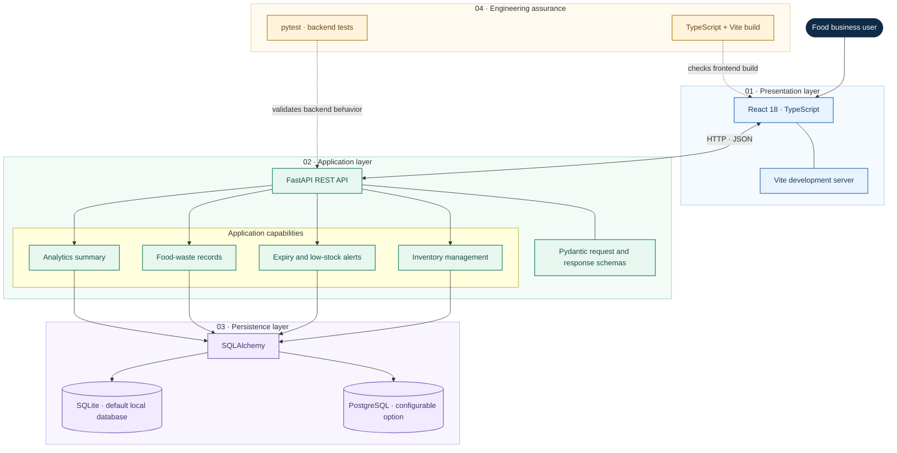

# HarvestGuard AI

**Smart Food Waste Prevention & Inventory Intelligence**

HarvestGuard AI helps small food businesses track perishable inventory,
monitor expiry risks, analyze food waste, and improve stock decisions. It is a
full-stack project built with React, TypeScript, FastAPI, and SQLAlchemy, with
SQLite as the default local database and PostgreSQL support configured through
the database URL.

The project also emphasizes production-engineering practices, including
automated testing, documented architecture, observability and incident-response
planning. Features described as planned are distinguished from those currently
implemented.

## Problem

Small food businesses may lack accessible tools to understand perishable
inventory, expiry risk, waste patterns, and the cost of stock that goes unused.
HarvestGuard AI provides an application foundation for managing stock and
turning inventory and waste records into actionable information.

## Current application features

The backend currently exposes API routes for:

- Listing, creating, retrieving, updating, and deleting inventory items
- Identifying items approaching expiry
- Identifying low-stock items
- Recording and listing food-waste records
- Returning an analytics summary
- Reporting backend health through `/health`

The React frontend provides an inventory dashboard connected to the backend.
Automated backend tests are included. See the testing documentation and run the
commands below to verify the current checkout.

## Architecture

HarvestGuard AI uses a layered architecture that separates the user interface,
API responsibilities, and data persistence.



### Local service endpoints

| Component | Local address |
|---|---|
| React dashboard | `http://127.0.0.1:5173/` |
| FastAPI health check | `http://127.0.0.1:8000/health` |
| Interactive API documentation | `http://127.0.0.1:8000/docs` |
| Inventory API | `http://127.0.0.1:8000/api/inventory` |

The frontend sends HTTP requests to the FastAPI backend. The backend uses
SQLAlchemy for database access, with SQLite as its default local database.
PostgreSQL can be configured through `DATABASE_URL`.

The tests and frontend build are verification activities, not runtime services.

**Deployment note:** Docker Compose files and Dockerfiles are not present in
the inspected checkout. Container orchestration, production CI/CD, and
observability should be documented as operational only after implementation
and verification.

## Technology stack

| Area | Technology |
|---|---|
| Frontend | React 18, TypeScript, Vite 6 |
| UI and charts | Lucide React, Recharts |
| Backend API | Python, FastAPI, Uvicorn |
| Data access | SQLAlchemy 2 |
| Local database | SQLite by default |
| Database option | PostgreSQL using `DATABASE_URL` and psycopg |
| Validation | Pydantic |
| Backend tests | pytest, HTTPX |
| Frontend checks | TypeScript compiler and Vite production build |

Version ranges are defined in `frontend/package.json` and
`backend/requirements.txt`. Observability, CI/CD, containerization, and
production deployment plans are documented separately and should not be
considered operational merely because documentation exists.

## Repository structure

```text
harvestguard-ai/
├── .env.example
├── .gitignore
├── AGENTS.md
├── README.md
├── backend/
│   ├── .env.example
│   ├── requirements.txt
│   ├── app/
│   │   ├── __init__.py
│   │   ├── database.py
│   │   ├── main.py
│   │   ├── models.py
│   │   └── schemas.py
│   └── tests/
│       └── test_api.py
├── docs/
│   ├── agents/
│   ├── issues/
│   ├── acceptance-criteria.md
│   ├── architecture.md
│   ├── deployment.md
│   ├── development-process.md
│   ├── incident-response.md
│   ├── observability.md
│   ├── rollback.md
│   ├── specification.md
│   └── testing.md
└── frontend/
    ├── package.json
    ├── package-lock.json
    ├── index.html
    ├── vite.config.ts
    └── src/
        ├── App.tsx
        ├── index.css
        └── main.tsx
```

## Run locally on Windows

Prerequisites:

- Python with a compatible version for the backend dependencies
- Node.js and npm
- The repository cloned or checked out locally

### 1. Start the backend

Open a PowerShell terminal in the repository root:

```powershell
cd backend
python -m venv .venv
.\.venv\Scripts\python.exe -m pip install -r requirements.txt
.\.venv\Scripts\python.exe -m uvicorn app.main:app --reload --host 127.0.0.1 --port 8000
```

If the project's existing `backend\.venv` is already set up, you can use it
without recreating it. Leave this terminal running.

### 2. Start the frontend

Open a second PowerShell terminal in the repository root:

```powershell
cd frontend
npm ci
npm run dev -- --host 127.0.0.1
```

Leave the frontend terminal running as well.

### 3. Open the application

| Service | Local URL |
|---|---|
| Frontend dashboard | http://127.0.0.1:5173/ |
| Backend health check | http://127.0.0.1:8000/health |
| Backend API documentation | http://127.0.0.1:8000/docs |
| Inventory API | http://127.0.0.1:8000/api/inventory |

The frontend is configured to request the backend at
`http://127.0.0.1:8000`. Keep the backend running while using the dashboard.

## Run tests and build

From the repository root, run the backend tests:

```powershell
cd backend
$env:PYTHONPATH = (Get-Location).Path
.\.venv\Scripts\python.exe -m pytest .\tests -q
```

Build the frontend:

```powershell
cd ..\frontend
npm ci
npm run build
```

A successful frontend build verifies TypeScript compilation and the Vite
production build. Review any build warnings separately from build failures.

## Docker Compose and deployment status

**Docker Compose is not configured in the current repository checkout.**
The expected Compose files and backend/frontend Dockerfiles were not present
when this README was prepared. Therefore, there is no verified Docker Compose
startup command yet.

Containerization, CI/CD, rollback, observability, and production deployment
remain subject to implementation and verification. See `docs/deployment.md`
for the deployment plan. Do not treat planned infrastructure as a working
production deployment.

## Documentation

- [Product specification](docs/specification.md)
- [Architecture](docs/architecture.md)
- [Acceptance criteria](docs/acceptance-criteria.md)
- [Agent team](docs/agents/team.md)
- [Development process](docs/development-process.md)
- [Testing](docs/testing.md)
- [Deployment](docs/deployment.md)
- [Rollback](docs/rollback.md)
- [Observability](docs/observability.md)
- [Incident response](docs/incident-response.md)
- [GitHub Issues plan](docs/issues/issue-plan.md)

## Responsible use

Use synthetic data for demonstrations. Never commit credentials, API keys,
production data, or unnecessary personal information. The incident responder
must use explicitly permitted actions and verify recovery independently.

## Project status

The application includes a React frontend, FastAPI backend, inventory and waste
API routes, database integration, and backend tests. Additional production
engineering capabilities should be marked complete only after their acceptance
criteria have been tested and the results documented.
